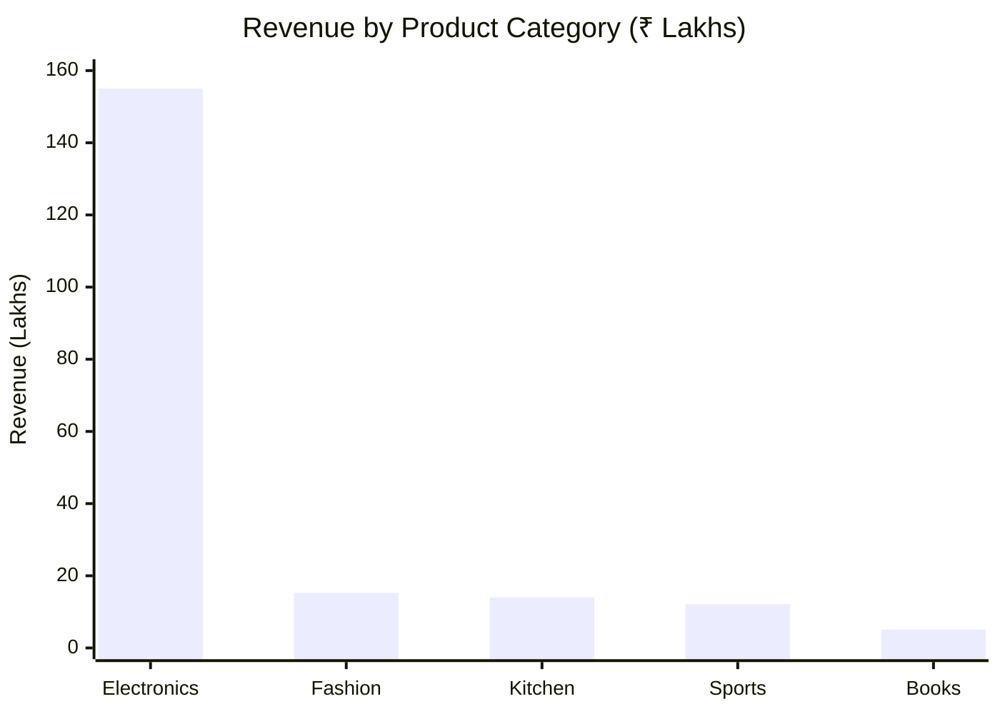
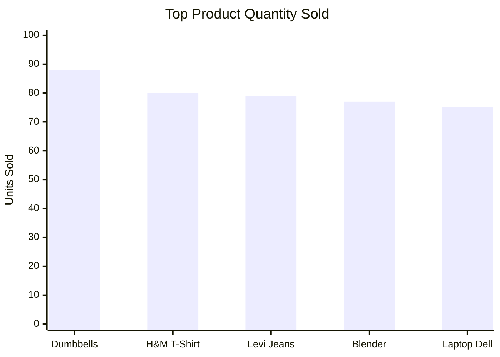
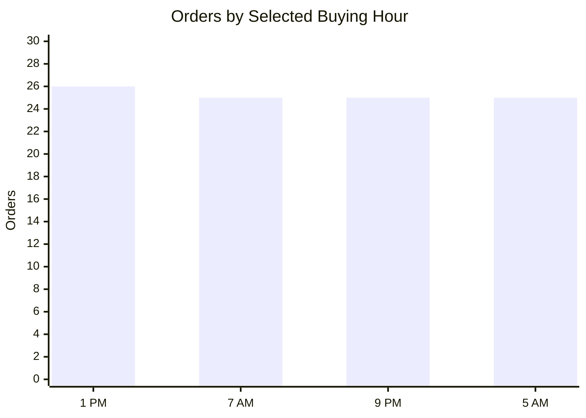
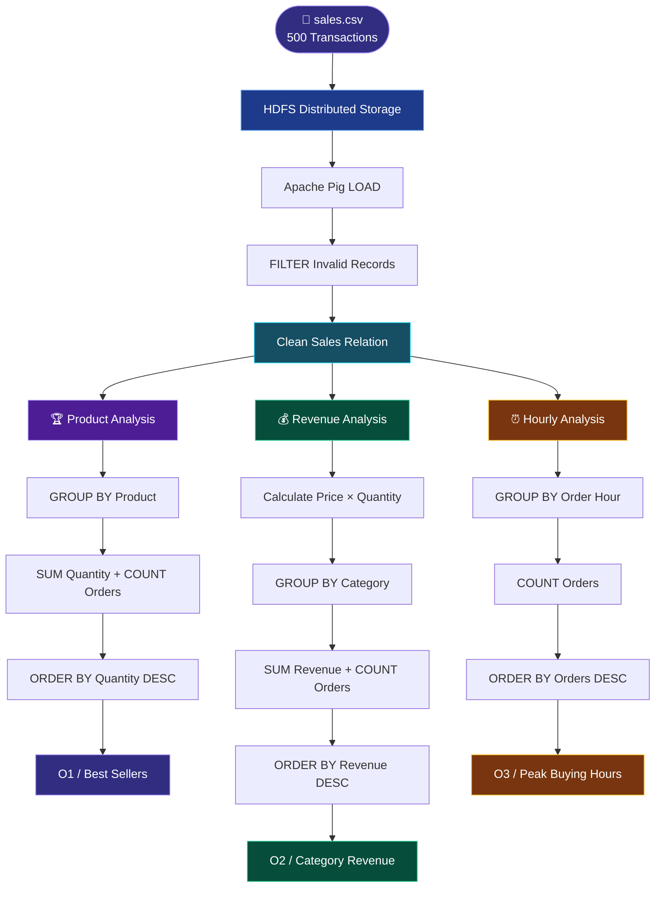
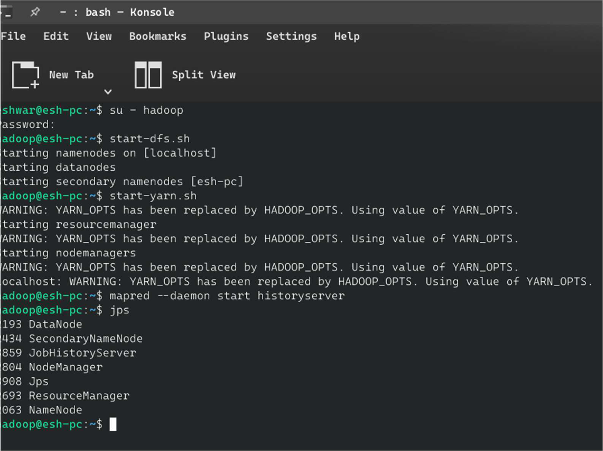
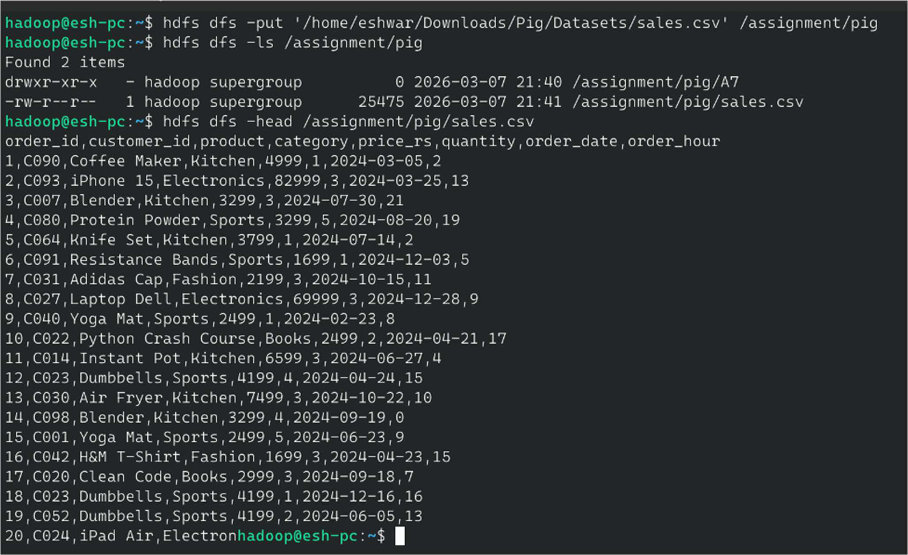
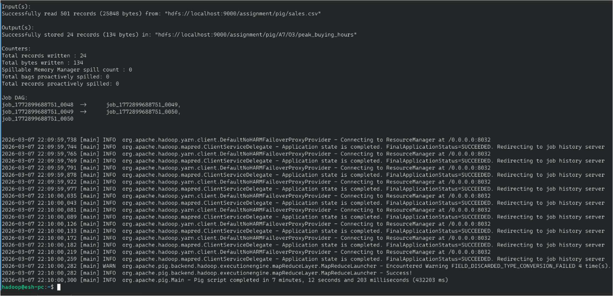
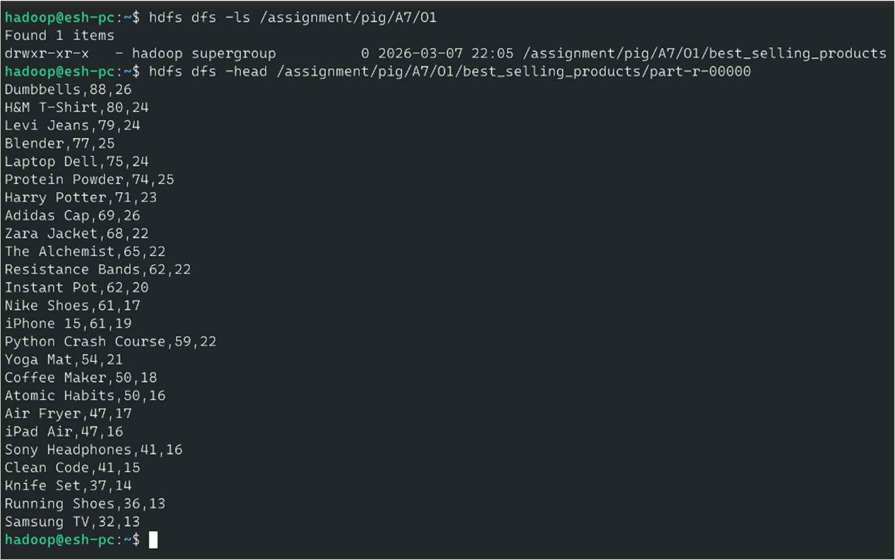
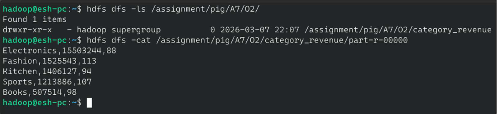
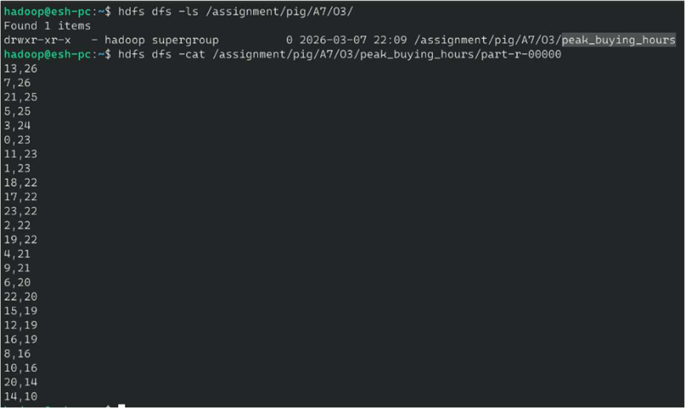

# 📊 PULSE ANALYTICS
<h3 align="center">E-COMMERCE SALES INTELLIGENCE ENGINE</h3>

<p align="center">
  <b>Transforming Raw Transactions Into Powerful Business Insights.</b>
</p>

<p align="center">
  An Apache Pig and Hadoop-based Big Data Analytics project that uncovers product performance, category revenue and customer buying patterns through distributed data processing.
</p>

<p align="center">
  
  
  
  
  
</p>

<p align="center">
  <a href="#-project-at-a-glance">OVERVIEW</a> •
  <a href="#-analytics-command-center">ANALYTICS</a> •
  <a href="#-data-processing-engine">WORKFLOW</a> •
  <a href="#-technology-stack">TECHNOLOGIES</a> •
  <a href="#-execution-guide">EXECUTION</a>
</p>

---

<p align="center">
  
</p>

## ◈ 01 — PROJECT AT A GLANCE

<table>
<tr>
<td width="65%" valign="top">

### What is Pulse Analytics?

Pulse Analytics is an E-Commerce Sales Analysis project built using **Apache Pig on Hadoop**.

It processes 500 transaction records and executes three analytical pipelines to extract valuable business insights.

Instead of manually analyzing thousands of sales entries, the system uses Pig Latin to perform data loading, filtering, grouping, aggregation, sorting and storage.

**The objective:** Turn raw sales data into meaningful information that supports better business decisions.

</td>
<td width="35%" align="center" valign="middle">

<h1>📦</h1>
<b>500</b>
<br/>Transaction Records

<hr/>

<h1>⚙️</h1>
<b>3</b>
<br/>Analytics Pipelines

<hr/>

<h1>📁</h1>
<b>3</b>
<br/>Separate Outputs

</td>
</tr>
</table>

---

## ◈ 02 — ANALYTICS COMMAND CENTER

<p align="center">
  <b>THREE ANALYTICAL ENGINES. ONE DATASET. MULTIPLE BUSINESS INSIGHTS.</b>
</p>

<table>
<tr>
<td align="center" width="33%">
<h1>🏆</h1>

### 01

**PRODUCT INTELLIGENCE**


Identify products with the highest sales volume.

</td>
<td align="center" width="33%">
<h1>💰</h1>

### 02

**REVENUE INTELLIGENCE**


Discover which product categories generate the most revenue.

</td>
<td align="center" width="33%">
<h1>⏰</h1>

### 03

**TIME INTELLIGENCE**


Identify the hours with the highest order activity.

</td>
</tr>
</table>

---

## ◈ 03 — EXPLORE THE THREE ANALYTICS MODULES

<details open>
<summary><b>🏆 MODULE 01 — BEST-SELLING PRODUCT ANALYSIS</b></summary>

<p align="center">
  
</p>

**Business Question:** Which products are selling the most?

**Processing Logic:**

1. Group transactions by product.
2. Calculate total quantity sold.
3. Count the number of orders.
4. Sort products in descending order of quantity.

**Sample Output:**

| Product | Quantity Sold | Orders |
|:---|---:|---:|
| Dumbbells | 88 | 26 |
| H&M T-Shirt | 80 | 24 |
| Levi Jeans | 79 | 24 |
| Blender | 77 | 25 |
| Laptop Dell | 75 | 24 |

**Business Insight:**

Dumbbells lead the sample sales data in terms of quantity sold. Such insights can help businesses plan inventory and identify popular products.

**Pig Latin Operations:**

`GROUP BY` → `FOREACH` → `SUM` → `COUNT` → `ORDER BY`

</details>

<details>
<summary><b>💰 MODULE 02 — CATEGORY-WISE REVENUE ANALYSIS</b></summary>

<p align="center">
  
</p>

**Business Question:** Which product category generates the highest revenue?

**Processing Logic:**

1. Calculate revenue for each transaction using price × quantity.
2. Group transactions by category.
3. Calculate total revenue.
4. Count category orders.
5. Rank categories by revenue.

**Sample Output:**

| Category | Total Revenue (₹) | Orders |
|:---|---:|---:|
| Electronics | 15,503,244 | 88 |
| Fashion | 1,525,543 | 113 |
| Kitchen | 1,406,127 | 94 |
| Sports | 1,213,886 | 107 |
| Books | 507,514 | 98 |

**Business Insight:**

Electronics generates the highest revenue despite having fewer orders than Fashion. Books generate the lowest revenue in this sample.

**Pig Latin Operations:**

`FOREACH` → `GROUP BY` → `SUM` → `COUNT` → `ORDER BY`

</details>

<details>
<summary><b>⏰ MODULE 03 — PEAK BUYING HOURS ANALYSIS</b></summary>

<p align="center">
  
</p>

**Business Question:** At what time do customers place the most orders?

**Processing Logic:**

1. Group transactions by order hour.
2. Count the number of orders for each hour.
3. Sort hours by order count.
4. Identify peak buying periods.

**Sample Output:**

| Hour | Orders |
|---|---:|
| 13:00 (1 PM) | 26 |
| 07:00 (7 AM) | 25 |
| 21:00 (9 PM) | 25 |
| 05:00 (5 AM) | 25 |

**Business Insight:**

1 PM records the highest order activity in the sample. Businesses can use these patterns to plan promotional campaigns and push notifications.

**Pig Latin Operations:**

`GROUP BY` → `FOREACH` → `COUNT` → `ORDER BY`

</details>

---

## ◈ 04 — INTERACTIVE DATA VISUALIZATION

### 📊 Category Revenue Comparison

The following chart uses the documented sample output.



### 🏆 Product Sales Performance



### ⏰ Peak Buying Hours



<sub>Charts visualize the sample results documented in the project. They are not live-connected dashboards.</sub>

---

## ◈ 05 — DATA PROCESSING ENGINE

<p align="center">
  <b>HOW RAW E-COMMERCE DATA BECOMES BUSINESS INTELLIGENCE</b>
</p>



---

## ◈ 06 — THE TECHNOLOGY STACK

<p align="center">
  <b>POWERED BY THE HADOOP ECOSYSTEM</b>
</p>

<table>
<tr>
<td align="center" width="33%">

### 🐘

**APACHE HADOOP**


Distributed storage and execution environment.

</td>
<td align="center" width="33%">

### 🐷

**APACHE PIG**


High-level dataflow processing.

</td>
<td align="center" width="33%">

### 🗄️

**HDFS**


Stores input datasets and analytical outputs.

</td>
</tr>
</table>

| Technology | Version | Role |
|---|---|---|
| Apache Hadoop | 3.4.1 | HDFS storage and YARN execution |
| Apache Pig | 0.17 | Dataflow processing |
| Pig Latin | — | Data transformation language |
| HDFS | 3.4.1 | Distributed file storage |
| PigStorage | Built-in | CSV input/output handling |

---

## ◈ 07 — UNDERSTANDING THE DATASET

### 📁 Transaction Data Schema

The dataset contains 500 e-commerce transaction records across five product categories.

| Field | Data Type | Description |
|---|---|---|
| `order_id` | INT | Unique order identifier |
| `customer_id` | STRING | Customer code |
| `product` | STRING | Product name |
| `category` | STRING | Product category |
| `price_rs` | INT | Unit price in rupees |
| `quantity` | INT | Units ordered |
| `order_date` | STRING | Order date |
| `order_hour` | INT | Hour of purchase (0–23) |

### 🏷️ Product Categories

<p align="center">
  
  
  
  
  
</p>

<details>
<summary><b>📄 Explore Sample Dataset Records</b></summary>

```csv
order_id,customer_id,product,category,price_rs,quantity,order_date,order_hour
1,C090,Coffee Maker,Kitchen,4999,1,2024-03-05,13
```

<sub>Illustrative sample row based on the documented schema.</sub>

</details>

---

## ◈ 08 — PIG LATIN LABORATORY

<details>
<summary><b>01 | LOAD AND FILTER DATA</b></summary>

```pig
sales_raw = LOAD 'hdfs://localhost:9000/assignment/pig/sales.csv'
    USING PigStorage(',')
    AS (
        order_id:int,
        customer_id:chararray,
        product:chararray,
        category:chararray,
        price_rs:int,
        quantity:int,
        order_date:chararray,
        order_hour:int
    );

sales = FILTER sales_raw
    BY order_id IS NOT NULL AND order_id != 0;
```

**Purpose:** Load structured sales data from HDFS and remove invalid records.

</details>

<details>
<summary><b>02 | BEST-SELLING PRODUCTS</b></summary>

```pig
grouped_products = GROUP sales BY product;

product_sales = FOREACH grouped_products GENERATE
    group AS product,
    SUM(sales.quantity) AS total_quantity,
    COUNT(sales) AS total_orders;

best_selling_products =
    ORDER product_sales BY total_quantity DESC;
```

**Purpose:** Rank products according to their total units sold.

</details>

<details>
<summary><b>03 | CATEGORY REVENUE</b></summary>

```pig
sales_with_revenue = FOREACH sales GENERATE
    category,
    (price_rs * quantity) AS revenue_rs;

grouped_category =
    GROUP sales_with_revenue BY category;

category_revenue = FOREACH grouped_category GENERATE
    group AS category,
    SUM(sales_with_revenue.revenue_rs) AS total_revenue_rs,
    COUNT(sales_with_revenue) AS total_orders;

sorted_category_revenue =
    ORDER category_revenue BY total_revenue_rs DESC;
```

**Purpose:** Calculate and rank revenue generated by each category.

</details>

<details>
<summary><b>04 | PEAK BUYING HOURS</b></summary>

```pig
grouped_hours = GROUP sales BY order_hour;

hourly_orders = FOREACH grouped_hours GENERATE
    group AS hour,
    COUNT(sales) AS total_orders;

peak_hours =
    ORDER hourly_orders BY total_orders DESC;
```

**Purpose:** Identify the hours with the highest order activity.

</details>

---

## ◈ 09 — PROJECT DIRECTORY

```text
ECommerce-Sales-Analysis-Apache-Pig/
│
├── src/
│   └── analysis.pig
│
├── data/
│   └── sales.csv
│
├── output/
│   ├── best_selling_products.txt
│   ├── category_revenue.txt
│   └── peak_buying_hours.txt
│
├── screenshots/
│   ├── hdfs_upload.png
│   ├── pig_execution.png
│   ├── output_bestsellers.png
│   ├── output_revenue.png
│   └── output_peakhours.png
│
└── run_pig_job.sh
```

---

## ◈ 10 — EXECUTION CONTROL CENTER

<details>
<summary><b>STEP 01 — Start Hadoop Services</b></summary>

```bash
su - hadoop
start-dfs.sh
start-yarn.sh
mapred --daemon start historyserver
jps
```

</details>

<details>
<summary><b>STEP 02 — Upload Dataset to HDFS</b></summary>

```bash
hdfs dfs -mkdir -p /assignment/pig

hdfs dfs -put data/sales.csv /assignment/pig/

hdfs dfs -ls /assignment/pig

hdfs dfs -head /assignment/pig/sales.csv
```

</details>

<details>
<summary><b>STEP 03 — Execute Apache Pig Script</b></summary>

```bash
pig src/analysis.pig
```

For local testing:

```bash
pig -x local src/analysis.pig
```

</details>

<details>
<summary><b>STEP 04 — Inspect Best-Selling Products</b></summary>

```bash
hdfs dfs -ls /assignment/pig/A7/O1

hdfs dfs -cat /assignment/pig/A7/O1/best_selling_products/part-r-00000
```

</details>

<details>
<summary><b>STEP 05 — Inspect Category Revenue</b></summary>

```bash
hdfs dfs -cat /assignment/pig/A7/O2/category_revenue/part-r-00000
```

</details>

<details>
<summary><b>STEP 06 — Inspect Peak Buying Hours</b></summary>

```bash
hdfs dfs -cat /assignment/pig/A7/O3/peak_buying_hours/part-r-00000
```

</details>

---

## ◈ 11 — EXECUTION SCREENSHOTS

<p align="center">
  <b>FROM HDFS DATA UPLOAD TO SUCCESSFUL ANALYTICS EXECUTION</b>
</p>

<details open>
<summary><b>📂 DATA UPLOAD & PIG EXECUTION</b></summary>

**01 — HDFS Dataset Upload**



**02 — Pig Script Execution**



**03 — Successful Execution**



</details>

<details>
<summary><b>📊 ANALYTICAL RESULTS</b></summary>

**04 — Best-Selling Products**



**05 — Category Revenue**



**06 — Peak Buying Hours**



</details>

---

## ◈ 12 — BUSINESS INTELLIGENCE INSIGHTS

<table>
<tr>
<td width="50%" valign="top">

### 🏆 Product Performance

Dumbbells record the highest sales quantity in the sample output.

**Business application:**

Inventory planning and product promotion.

</td>
<td width="50%" valign="top">

### 💰 Revenue Performance

Electronics leads category revenue with ₹1,55,03,244.

**Business application:**

Revenue optimization and category strategy.

</td>
</tr>
<tr>
<td width="50%" valign="top">

### ⏰ Customer Buying Behaviour

1 PM records the highest order count with 26 orders.

**Business application:**

Promotional scheduling and campaign timing.

</td>
<td width="50%" valign="top">

### 📦 Inventory & Marketing

Sales volume and revenue together offer useful product performance insights.

**Business application:**

Flash-sale planning and product selection.

</td>
</tr>
</table>

---

## ◈ 13 — HADOOP & APACHE PIG CONCEPTS

<details>
<summary><b>Explore the Pig Latin operators used</b></summary>

| Operator | Function |
|---|---|
| `LOAD` | Load input data |
| `FILTER` | Remove unwanted records |
| `GROUP` | Group records by a field |
| `FOREACH` | Transform records |
| `GENERATE` | Select or calculate output fields |
| `SUM` | Calculate totals |
| `COUNT` | Count records |
| `ORDER` | Sort results |
| `STORE` | Save results |
| `DUMP` | Display results in the console |

</details>

---

## ◈ 14 — SCALABILITY & FUTURE SCOPE

### 🚀 Potential Extensions

| Enhancement | Opportunity |
|---|---|
| 📅 Monthly Revenue Trends | Analyze seasonal performance |
| 👤 Customer Segmentation | Identify customer purchasing patterns |
| 🤝 Product Catalog Join | Enrich product information |
| 📊 Apache Zeppelin | Interactive analytics notebooks |
| ⚡ Spark SQL Migration | Explore alternative large-scale processing |

### 📈 Big Data Learning Perspective

The project demonstrates how Apache Pig expresses multi-step transformations and how Hadoop provides distributed storage and execution infrastructure.

Larger data volumes would require appropriate cluster resources and configuration; the scale examples below are conceptual rather than benchmarked results.

---

## ◈ 15 — LEARNING OUTCOMES

- [x] Loaded and filtered structured sales data using Pig Latin.
- [x] Implemented `GROUP BY`, `FOREACH` and `ORDER BY`.
- [x] Calculated category revenue using derived fields.
- [x] Generated three analytical outputs.
- [x] Stored outputs in separate HDFS directories.
- [x] Interpreted sales data to identify business insights.

---

## ◈ 16 — PROJECT CREDITS

<p align="center">
  
</p>

<p align="center">
  <b>Developed by Eshwar G</b>
  <br/>
  <sub>Big Data Analytics | Apache Hadoop | Apache Pig</sub>
</p>

<p align="center">
  <a href="https://github.com/meghanagowda75">
    
  </a>
</p>

<p align="center">
  ⭐ If you find this project interesting, give the repository a star!
</p>

<h2 align="center">📊 DATA INTO INSIGHTS. INSIGHTS INTO DECISIONS.</h2>

<p align="center">
  <i>Powered by Apache Pig. Driven by Big Data.</i>
</p>

<p align="center">
  
</p>
